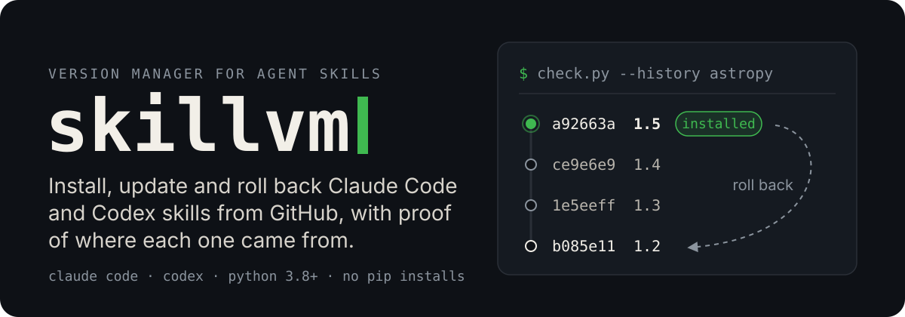
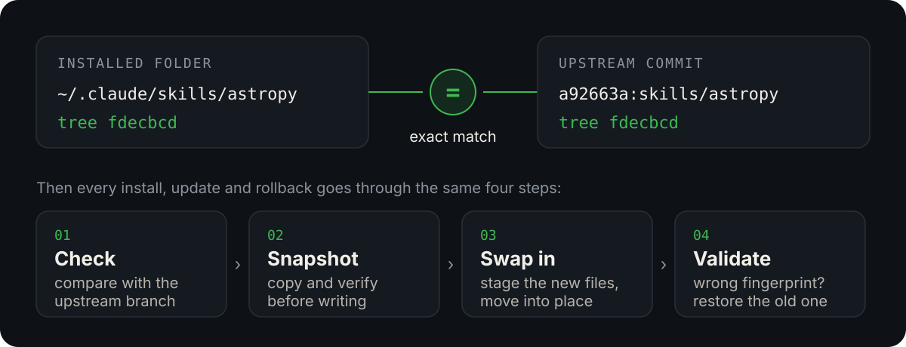

<p align="center">
  
</p>

<p align="center">
  <a href="https://github.com/MarouTom/skillvm/stargazers"></a>
  <a href="https://github.com/MarouTom/skillvm/releases/latest"></a>
  <a href="./LICENSE"></a>
  <a href="#install"></a>
  <a href="#install"></a>
  <a href="#install"></a>
  <a href="#install"></a>
</p>

<p align="center">
  <a href="#install">Install</a> ·
  <a href="#use">Use</a> ·
  <a href="#examples">Examples</a> ·
  <a href="#how-it-works">How it works</a> ·
  <a href="#safety">Safety</a> ·
  <a href="#use-the-scripts-directly">Scripts</a>
</p>

**skillvm** is a skill for **Claude Code** and **Codex** that keeps all your skills up to date. Just say *"update my skills."* It finds where each skill came from on GitHub, shows you what changed, and updates them. If an update breaks something, you can go back to the old version. It works with the skills you already have, so there's nothing to reinstall.

- **Knows where each skill came from**, even ones you copied months ago.
- **Shows what changed** in every update, and flags changes to scripts or permissions with **⚠ review**.
- **Lets you go back** to any earlier version.
- **Leaves your edits alone** unless you say otherwise.
- **Finds new skills.** Ask for *"skills for data management"* and it searches GitHub for you.

## What a run looks like

Every run ends with the same report, so results are easy to scan and compare:

> **Skill changes · 2026-10-27 10:03 · update**
>
> | # | Skill | Action | From | To | Source |
> |---|---|---|---|---|---|
> | 1 | chart-maker | updated | 1.2 · `3f9c2a1` · 2026-09-14 | 1.4 · `8b7e4d0` · 2026-10-20 | MarouTom/agent-skills |
> | 2 | pdf-toolkit | updated | — · `c41d9e7` · 2026-08-30 | — · `5a2f0b3` · 2026-10-11 | MarouTom/agent-skills |
> | 3 | blog-post | installed | — | 2.0 · `e77c215` · 2026-10-02 | MarouTom/writing-skills |
>
> **What changed**
> 1. **chart-maker**: 3 commits · 5 files (+212 −48)
>    - `8b7e4d0` Add dark-mode palettes
>    - `61aa3f2` Fix legend overlap on small charts
>    - `2d9e0c4` Support SVG export
>    - ⚠ review: changes `scripts/render_chart.py` (+1 test file)
>    - snapshot `20261027T090345Z` holds the previous version
> 2. **pdf-toolkit**: 1 commit · 2 files (+31 −9)
>    - `5a2f0b3` Handle encrypted PDFs gracefully
>    - snapshot `20261027T090346Z` holds the previous version
> 3. **blog-post**: new skill · 6 files
>    - ⚠ review: allowed-tools `Read Write`
>
> **Not changed**
> - Up to date: 41
> - Skipped: sql-helper (pinned) · meeting-notes (local edits kept)
> - Failed: none
>
> Undo any row by asking to roll that skill back. Changes take effect in a new session.

From and To are `version · commit · date`, and `—` means the skill has no `version:` field. The `⚠ review` lines are there because an update can change what code runs on your machine.

## Install

### As a Claude Code plugin

```bash
claude plugin marketplace add MarouTom/skillvm
claude plugin install skillvm@skillvm
```

Invoke it with `/skillvm:skillvm`, and get new versions with `claude plugin update skillvm@skillvm`.

### As a skill folder (Claude Code and Codex)

```bash
git clone --depth 1 https://github.com/MarouTom/skillvm.git /tmp/skillvm
```

Then copy the skill into the skills folder of each agent you use:

| Agent | Command | Invoke with |
|---|---|---|
| **Claude Code** | `cp -R /tmp/skillvm/skillvm ~/.claude/skills/` | `/skillvm` |
| **Codex** | `cp -R /tmp/skillvm/skillvm ~/.codex/skills/` | `$skillvm` |

If you've set `CODEX_HOME`, copy into `$CODEX_HOME/skills` instead. Start a new session afterwards. Each copy manages the skills of the agent it's installed in, and can update itself along with them.

> **Requirements:** `git`, `curl`, and Python 3.8+. It uses only the standard library, so there's nothing to `pip install`.

## Use

Just ask, in plain language:

> 💭 *Check my skills for updates.*<br>
> 💭 *Update everything.* · *Update chart-maker and pdf-toolkit.* · *Update all the writing-\* skills.*<br>
> 💭 *Find skills for spreadsheet cleanup.* · *Tell me more about number 2.* · *Install 1 and 3.*<br>
> 💭 *Install the skillvm skill from MarouTom/skillvm.*<br>
> 💭 *What changed in chart-maker?* · *Show me the previous versions of pdf-toolkit.*<br>
> 💭 *Undo the last update to sql-helper.* · *Go back to chart-maker 1.2.* · *Keep chart-maker at this version.*

Or pass arguments: `/skillvm …` in Claude Code, `$skillvm …` in Codex.

```
--search "spreadsheet cleanup"            find skills on GitHub, top 10 by stars
--check                                   what's outdated? changes nothing
all                                       update everything (previews first, asks once)
chart-maker pdf-toolkit                   update specific skills
--install MarouTom/skillvm [skill …]
--install https://github.com/MarouTom/skillvm/tree/main/skillvm
--history chart-maker                     local snapshots + every upstream version
--rollback chart-maker [1.2 | <commit> | <tag> | <snapshot> | <date>]
--pin chart-maker [<version>]             "update all" leaves it alone
--unpin chart-maker
```

Ask in any language. Results come back in yours, while skill names, links and commands stay exactly as they are.

## Examples

### List every version of a skill, then restore one

> 💭 *Show me all the versions of chart-maker.*

You get two kinds of versions: **local snapshots** (what this machine has had) and **upstream versions** (everything ever published).

> **Version history · chart-maker**
>
> **Local snapshots**
>
> | Snapshot | Version | Commit | Reason | Taken (UTC) |
> |---|---|---|---|---|
> | `20261027T090345Z` | 1.2 | `3f9c2a1` | pre-update | 2026-10-27 09:03 |
>
> **Upstream versions** · MarouTom/agent-skills · `skills/chart-maker` · newest first
>
> | Commit | Date | Version | Tags | Subject |
> |---|---|---|---|---|
> | `8b7e4d0` ← installed | 2026-10-20 | 1.4 | v1.4.0 | Add dark-mode palettes |
> | `61aa3f2` | 2026-10-08 | 1.3 | | Fix legend overlap on small charts |
> | `2d9e0c4` | 2026-10-01 | 1.3 | v1.3.0 | Support SVG export |
> | `3f9c2a1` | 2026-09-14 | 1.2 | v1.2.0 | Add heatmap charts |
> | `7e5a1c8` | 2026-08-02 | 1.1 | v1.1.0 | Add axis label rotation |
> | `5c1b7f9` | 2026-07-11 | 1.0 | v1.0.0 | First release |

Pick any row and ask for it:

| You say | Restores |
|---|---|
| *Go back to chart-maker 1.1* | the newest commit with `version: 1.1` |
| *Restore chart-maker to v1.3.0* · *…to `2d9e0c4`* | that tag or commit |
| *Restore the chart-maker snapshot `20261027T090345Z`* | that local snapshot |
| *Restore chart-maker as it was on 2026-10-27* | the newest snapshot from on or before that day |
| *Undo the last update to chart-maker* | the snapshot taken just before it |

After a rollback, the agent asks whether to **pin** the skill, so *"update all"* doesn't bring the newer version back. Asking for a version that doesn't exist gets you the list of versions that do.

<details>
<summary><b>Show the rollback report</b></summary>

> 💭 *Go back to chart-maker 1.1.*

> **Skill changes · 2026-10-27 10:15 · rollback**
>
> | # | Skill | Action | From | To | Source |
> |---|---|---|---|---|---|
> | 1 | chart-maker | rolled back | 1.4 · `8b7e4d0` · 2026-10-20 | 1.1 · `7e5a1c8` · 2026-08-02 | MarouTom/agent-skills |
>
> **What changed**
> 1. **chart-maker**: restored upstream `7e5a1c8`
>    - snapshot `20261027T101502Z` holds the version you rolled back from
>
> **Not changed**
> - Up to date: 0
> - Skipped: none
> - Failed: none
>
> Undo any row by asking to roll that skill back. Changes take effect in a new session.
>
> *Pin chart-maker at 1.1, so "update all" doesn't bring 1.4 back?*

</details>

### Find new skills, learn about one, install it

> 💭 *Find skills for spreadsheet cleanup.*

skillvm searches GitHub (repos tagged `agent-skills` or `claude-skills`, plus the biggest skill collections), reads each candidate's `SKILL.md`, and keeps the skills that match. The top 10 are ranked by stars:

> **Skill search · "spreadsheet cleanup" · top 10 by GitHub stars**
>
> | # | Skill | What it does | Repo | ★ | Updated | Notes |
> |---|---|---|---|---|---|---|
> | 1 | **csv-wrangler** | Clean, deduplicate, and reshape CSV and Excel files. | MarouTom/agent-skills | 12,480 | 2026-10-14 | v2.1 · 3 scripts |
> | 2 | **sheet-auditor** | Find broken formulas, mixed types, and outliers in spreadsheets. | MarouTom/data-skills | 2,315 | 2026-09-30 | v1.0 |
> | 3 | **tidy-tables** | Turn messy tables into tidy, analysis-ready data. | dataworks-lab/tidy-skills | 640 | 2026-08-12 | 1 script |
> | … | | | | | | |

> 💭 *Tell me more about number 2.*

> **sheet-auditor** checks a spreadsheet before you trust it: it finds formulas that return errors, columns that mix numbers and text, and values far outside the usual range, then explains each problem with its cell reference.
>
> **You could ask it:**
> - *"Audit budget-2026.xlsx before I send it to finance."*
> - *"Why does the total in column F not match the sum of the rows?"*
> - *"List the outliers in the sales sheet and suggest which ones are typos."*
>
> **What it installs:** 4 files, no scripts, no special tool permissions.<br>
> **Source:** MarouTom/data-skills · ★ 2,315 · MIT · last updated 2026-09-30

> 💭 *Install 1 and 3.*

Both are installed with the usual report, snapshot, and ⚠ review flags. Results you already have are marked `installed`.

## How it works

<p align="center">
  
</p>

1. **Proof by fingerprint.** A skill folder's fingerprint is its git tree id, the same id git gives that folder inside a repo. If an installed folder's fingerprint equals the tree at an upstream commit, that is exactly the version you have. It's a proof, not a guess based on the name. If the repo has the skill but no commit matches, you edited it or it came from a fork, and skillvm asks before recording anything.
2. **Finding sources.** On the first run, skillvm records where each installed skill came from. It checks install notes left by other installers, GitHub links in the skills' own files, and GitHub search by author. One repo found this way often resolves dozens of skills at once: on a test machine with 222 skills, 177 of them with no install records, every skill was matched in under a minute.
3. **Snapshots before every change.** Before an update, install or rollback writes anything, the current folder is copied to `skill-versions/snapshots/<skill>/<timestamp>/` and the copy is verified. The new version is then staged, swapped in, and checked against its expected fingerprint. If that check fails, the old folder is put straight back.
4. **Cheap fetching.** Repos are cloned blobless into a private cache, which holds only branches, tags, commits and folder structure. File contents are downloaded in one batch, and only for the skill being installed. A 170-skill repo is about 2 MB and takes a second. Checks, fingerprints and fetches run in parallel, so checking 200+ skills takes a few seconds. Your own git clones are never touched.

## Claude Code and Codex

Each installed copy manages the skills of the agent it's installed in, and keeps its own state next to them:

| Installed in | Manages | State |
|---|---|---|
| `~/.claude/skills/` | Claude Code skills | `~/.claude/skill-versions/` |
| `~/.codex/skills/` (or `$CODEX_HOME/skills`) | Codex skills | `~/.codex/skill-versions/` |
| `~/.agents/skills/` | the shared agents folder | `~/.agents/skill-versions/` |

- **Manage the other agent's skills from either one.** Add `--agent codex` or `--agent claude` (*"check my Codex skills for updates"*).
- **Sources are shared.** If your Claude copy already knows where a skill comes from, the Codex copy tries that repo first, and the other way round.
- **Agent-specific copies.** When a repo keeps one copy of a skill per agent (`.claude/skills/x`, `.codex/skills/x`, `.agents/skills/x`), each agent gets its own.
- **Codex sandbox.** Fetching from GitHub and writing to `~/.codex/skills` happen outside the workspace sandbox, so Codex asks you to approve those commands. Checks can also run offline from the cache with `--no-fetch`.

The skill's frontmatter uses only fields both agents accept, and it passes Codex's skill validator. `agents/openai.yaml` gives Codex a display name and a default prompt.

## Safety

- **Local edits** are detected by fingerprint and never overwritten without your answer. When you do overwrite, the edits stay in a snapshot.
- **New skills and updates** that add or change scripts, `allowed-tools` or hooks are flagged for review.
- **Upstream files** are written only inside the skill folder. Absolute paths, `..`, and links that escape the folder stop the install.
- **Symlinked skills** (your development copies) are never modified.
- **Built-in skills**, such as Codex's `.system` folder, are never touched.
- **Upstream history rewrites** (force-push, rebase, squash) are handled. The installed version is re-matched by fingerprint. If it no longer exists upstream, the skill is treated as locally modified and replaced only when you agree.
- **No password prompts.** Git never waits for a password: a private or missing repo fails at once and is reported as unreachable.
- **One folder of state** per agent (`~/.claude/skill-versions/`, `~/.codex/skill-versions/`). Delete it to start over; your skills aren't affected.

## Use the scripts directly

The skill is a thin layer over four scripts, which you can also run yourself.

<details>
<summary><b>Show commands</b></summary>

```bash
S=~/.claude/skills/skillvm/scripts      # or ~/.codex/skills/skillvm/scripts
python3 $S/bootstrap.py --search                  # build the registry (safe to re-run)
python3 $S/search.py "spreadsheet cleanup"        # find skills on GitHub, top 10 by stars
python3 $S/search.py --details 2                  # everything about result 2
python3 $S/apply.py install --from-search 1 3     # install results by number
python3 $S/check.py                               # what's outdated?
python3 $S/check.py --history chart-maker         # local snapshots + upstream versions
python3 $S/check.py --diff chart-maker            # your local edits
python3 $S/apply.py update all --dry-run          # preview
python3 $S/apply.py update all
python3 $S/apply.py install MarouTom/skillvm skillvm
python3 $S/apply.py rollback chart-maker 1.2
python3 $S/apply.py pin chart-maker
```

Each script takes `--help`. Exit code `2` means a decision is needed; the output says which.

- **Another agent's skills.** Pass `--agent claude|codex|agents`.
- **Project skills, or any other folder.** Pass `--skills-dir <repo>/.claude/skills` (or `.codex/skills`). The scripts work with any folder of `SKILL.md` skills.
- With `apply.py`, these options go before the subcommand: `apply.py --agent codex update all`.
- **Separate state.** Set `SKILLVM_STORE=/some/folder` to keep the registry and snapshots somewhere else, for example for testing.

</details>

<details>
<summary><b>Repository layout</b></summary>

```
skillvm/
├── SKILL.md               what the agent follows: which script to run, and how to handle decisions
├── agents/
│   └── openai.yaml        Codex display metadata
├── scripts/
│   ├── lib.py             fingerprints, registry, fetching, snapshots, the report
│   ├── bootstrap.py       find and confirm where installed skills came from
│   ├── check.py           check for updates, version history, local diffs (read-only)
│   ├── search.py          find skills on GitHub by topic, ranked by stars (read-only)
│   └── apply.py           update, rollback, install, pin, unpin
└── references/
    ├── sources.md         registry format and source resolution, step by step
    └── versions.md        fingerprints, snapshots, staging, history, retention
```

</details>

## Limitations

- **Git sources only.** Skills distributed as zip files or single files can't be tracked. Non-GitHub git hosts work for install and update, but GitHub search only finds GitHub repos.
- **Plugin-managed skills.** Skills that come with an agent's plugins belong to that agent; update them through its own tools.
- **Rate limits.** Unauthenticated GitHub search allows about 10 requests a minute, and one search uses 5. skillvm runs at full speed while the limit allows, waits when it runs out, and stops cleanly if the wait would be long. Set `GH_TOKEN` or `GITHUB_TOKEN` to raise the limit to 30 a minute. Repeat searches reuse what earlier ones read from repos that haven't changed since.
- **Snapshots are local.** They live on this machine, and the 10 newest per skill are kept.

## Contributing

Issues and pull requests are welcome. To test changes without touching your real skills, point both the skills folder and the state folder at a scratch copy:

```bash
SKILLVM_STORE=/tmp/skillvm-test python3 skillvm/scripts/bootstrap.py --skills-dir /tmp/test-skills --search
```
